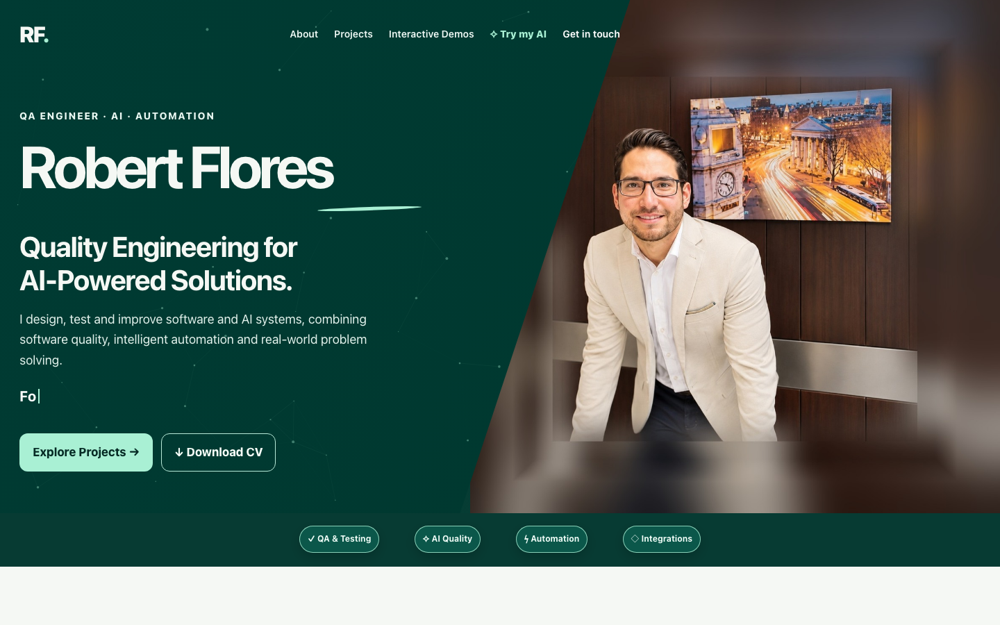

# Robert Flores | QA Engineering & AI Quality

**Quality Assurance Engineer · Test Automation · AI Quality · AI Agent Testing**

I build and validate reliable software experiences, combining hands-on quality engineering with automation, CI/CD practices, and evaluation of AI-powered workflows.

[**Explore the live portfolio**](https://robert-flores-portfolio.robertdorlan2501.workers.dev/) · [**LinkedIn**](https://www.linkedin.com/in/robert-dorlan/)



## About this portfolio

An interactive professional website presenting my experience in software testing, test automation, and quality assurance for AI-enabled products. It includes selected projects, interactive QA demonstrations, and a live AI assistant that can answer questions about my professional background.

## Featured work

| Project / area | What it demonstrates |
| --- | --- |
| **Kronoly — AI Booking Agent QA** | QA approaches for AI-assisted booking experiences and conversational workflows |
| **AI-Assisted QA Lifecycle** | Applying AI assistance across quality engineering activities |
| **Rental Enquiry Workflow** | Automation of structured customer enquiries and workflow decisions |
| **Enterprise Software Quality** | Quality assurance in enterprise software environments |
| **AI-Assisted Career Services** | Exploring AI-supported professional service workflows |

These are portfolio case studies and demonstrations; their inclusion does not imply that all associated systems or tests are publicly available in this repository.

## Interactive experiences

- **AI Automation Playground:** interactive enquiry and booking scenario demonstrations
- **Execution report:** visual feedback from portfolio demonstrations
- **Ask my AI:** a production-hosted assistant that answers recruiter questions using a curated professional knowledge base

The live assistant requires a separate Cloudflare backend and is **not** functional when opening the static HTML locally.

## Skills & technologies

**Quality engineering:** manual and exploratory testing, test strategy, regression testing, release readiness, quality gates

**Test automation:** Playwright, Robot Framework, Tricentis Tosca

**AI quality:** AI agent evaluation, conversational workflow validation, AI-assisted QA

**Delivery & integrations:** CI/CD, GitHub Actions, workflow automation, API integrations

**Website:** HTML, CSS, JavaScript; hosted with Cloudflare Workers and static assets

## Architecture overview

```text
Browser
  |
  +-- Public website (HTML / CSS / JavaScript)
  |      +-- Projects and professional background
  |      +-- Interactive client-side demonstrations
  |
  +-- AI assistant request (live deployment only)
         |
         +-- Cloudflare Worker API
                +-- Request validation and usage controls
                +-- D1 usage counters
                +-- OpenAI API (server-side secret)
```

The diagram describes the live deployment at a high level. This repository intentionally includes only the **public-facing website assets**.

## Repository contents

```text
.
├── README.md
├── index.html
├── portrait.jpg
├── favicon.svg
├── Robert_Flores_AI_Quality_CV.pdf
└── assets/
    └── portfolio-home.png
```

## Running the public site locally

Clone this repository and serve it with any local static file server:

```bash
git clone https://github.com/RobertDorlan/qa-engineering-portfolio.git
cd qa-engineering-portfolio
python3 -m http.server 8000
```

Then open **http://localhost:8000**.

The public page and client-side demonstrations can be explored locally. Server-dependent features such as the AI assistant require the separate production backend.

## Security and scope

No API keys, Cloudflare secrets, private environment files, server-side AI assistant code, or production usage database are included in this repository. The published Cloudflare portfolio is maintained separately; changes to this repository **do not automatically deploy** to the live website.

## Contact

- **Portfolio:** https://robert-flores-portfolio.robertdorlan2501.workers.dev/
- **LinkedIn:** https://www.linkedin.com/in/robert-dorlan/


## Automated QA engineering demo

A runnable **Playwright + TypeScript** suite lives in [`playwright-qa-demo/`](playwright-qa-demo/README.md). It tests a fictional booking sandbox with eight independent positive/negative scenarios, Page Object Model, accessibility-first locators, and GitHub Actions CI. No production systems or private project data are involved.
